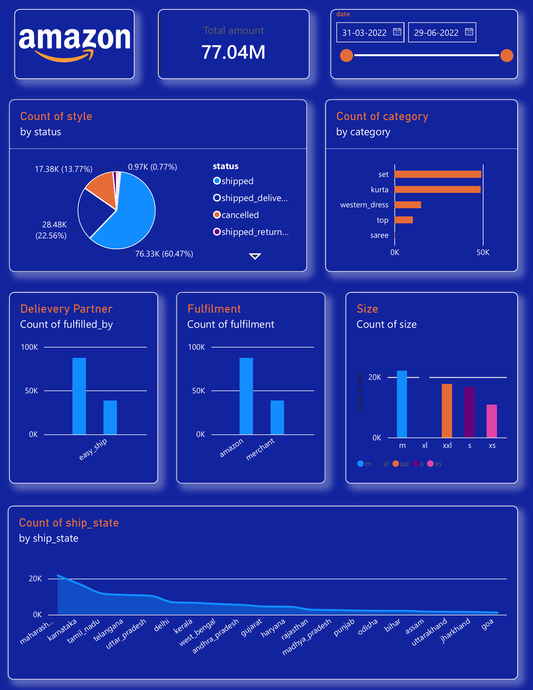

# Power BI Dashboards

Two interactive Power BI dashboards: a **cricket player performance dashboard** (Virat Kohli career statistics) and an **e-commerce sales dashboard** (Amazon India orders).

| Folder | Dashboard | Domain | Files |
|---|---|---|---|
| `dashboard 1` | [Virat Kohli Career Statistics](#dashboard-1-virat-kohli-career-statistics) | Sports analytics | [.pbix](<dashboard 1/virat statistics dashboard.pbix>) · [PDF](<dashboard 1/virat statistics dashboard.pdf>) |
| `dashboard 2` | [Amazon Sales](#dashboard-2-amazon-sales) | E-commerce / retail | [.pbix](<dashboard 2/amazon sales dashboard.pbix>) · [PDF](<dashboard 2/amazon sales dashboard.pdf>) · [Data (xlsx)](<dashboard 1/amazon_sales_cleaned data.xlsx>) |

---

## Dashboard 1: Virat Kohli Career Statistics

**Business question:** how has Virat Kohli's batting performance changed over the years and across formats (ODI, Test, T20I)?


**Dataset:** year-wise batting statistics of V Kohli from [CricMetric](https://www.cricmetric.com/playerstats.py?player=V%20Kohli).

**What the dashboard shows**
- **Slicers:** year range (2008 to 2026) and format (ODI / Test / T20I).
- **KPI cards:** total runs, innings, average and strike rate. The exported view shows **9,230 runs in 210 innings**.
- **Runs by year:** bar chart of yearly runs.
- **Boundaries:** fours and sixes.
- **100s and 50s by year:** trend of centuries and half-centuries.

---

## Dashboard 2: Amazon Sales

**Business question:** how are orders distributed across status, category, size, fulfilment method and state, and how much revenue do they bring in?



**Dataset:** [amazon_sales_cleaned data.xlsx](<dashboard 1/amazon_sales_cleaned data.xlsx>), 126,241 rows and 14 columns (`date, status, fulfilment, sales_channel, ship_service_level, style, sku, category, size, qty, amount, ship_state, b2b, fulfilled_by`), covering 31 Mar 2022 to 29 Jun 2022.

**What the dashboard shows**
- **KPI card:** total order amount, 77.04M, with a **date range slicer**.
- **Order status:** share of orders by status in a pie chart.
- **Category:** number of orders by product category.
- **Fulfilment:** orders fulfilled by Amazon vs merchant (Easy Ship).
- **Size:** number of orders by size.
- **Geography:** number of orders by shipping state.

**Key insights**
- **Set and Kurta dominate:** together they make up about 78% of all orders (49,237 and 48,901 orders).
- **Order status:** 60.5% of orders are "shipped", 22.6% are "delivered to buyer" and **13.8% are cancelled** (17,382 orders).
- **Fulfilment:** Amazon fulfils about 69% of orders and merchants (Easy Ship) about 31%.
- **Top states by orders:** Maharashtra (21,786), Karnataka (16,650) and Tamil Nadu (11,553), followed by Telangana and Uttar Pradesh.
- **Most ordered size:** M (22,165 orders), closely followed by L and XL.

**Notes**
- The 77.04M total **includes cancelled orders** (about 6.5M) and returned orders, so revenue from completed orders is lower.
- Almost all of the data is from April to June 2022; March has only one day.
- The dataset has no currency column and no order ID.

---

## How to Open
Download the `.pbix` file and open it in **Power BI Desktop** (free). The PDF versions can be viewed directly on GitHub.

## Tools Used
- **Power BI Desktop:** data model, visuals, slicers and dashboard layout
- **Excel:** source data

## Repository Structure
```
powerbi-dashboards/
├── dashboard 1/
│   ├── virat statistics dashboard.pbix
│   ├── virat statistics dashboard.pdf
│   └── amazon_sales_cleaned data.xlsx
├── dashboard 2/
│   ├── amazon sales dashboard.pbix
│   └── amazon sales dashboard.pdf
└── README.md
```

## Author
**Aakanksha Singh Sengar**: [GitHub](https://github.com/Aakanksha-sengar) | [LinkedIn](https://www.linkedin.com/in/aakanksha-singh-sengar-b254a1338)
